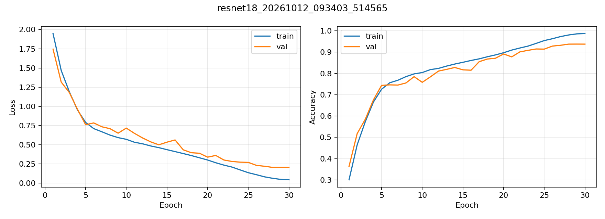
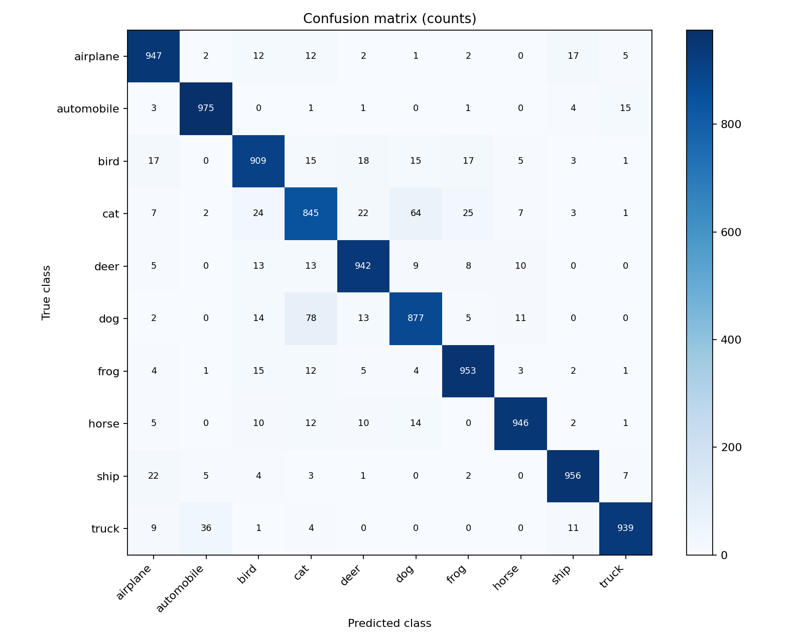

# CIFAR-10 图像分类：ResNet18 实验

本项目使用 PyTorch 实现 CIFAR-10 图像分类实验，采用针对 32×32 图像调整的 ResNet18，从随机初始化开始训练。项目包含数据划分、模型训练、验证选模、独立测试及结果可视化。

**正式实验已完成：训练 30 轮，在官方 10,000 张测试图片上的 Top-1 准确率为 92.89%。** 模型按验证集准确率选择，测试集不参与训练和最佳轮次选择。

## 1. 实验结果

实验编号：`resnet18_20261012_093403_514565`；实验日期：2026-10-12。

| 指标 | 结果 |
|---|---:|
| 官方测试集 Top-1 准确率 | **92.89%（9,289 / 10,000）** |
| 测试集平均交叉熵损失 | 0.2351 |
| 最佳验证集准确率 | 93.76% |
| 最佳模型所在轮次 | 第 29 轮 |
| 总训练轮数 | 30 |
| 训练阶段耗时 | 约 26 分 8 秒 |

训练耗时包含每轮验证与结果保存，不含数据下载和最后的测试集评估。以上为 **seed=42 的单次实验结果**，尚未进行多随机种子重复实验。

原始记录：

- [实验报告](evaluation/resnet18_20261012_093403_514565/report.md)
- [测试指标及各类别准确率（JSON）](evaluation/resnet18_20261012_093403_514565/metrics.json)
- [30 轮训练与验证记录（CSV）](experiments/resnet18_20261012_093403_514565/history.csv)
- [本次运行配置](experiments/resnet18_20261012_093403_514565/config.json)
- [运行环境记录](experiments/resnet18_20261012_093403_514565/environment.json)
- [训练/验证样本划分索引](experiments/resnet18_20261012_093403_514565/split_indices.json)
- [最佳模型权重（约 42.7 MiB，第 29 轮）](checkpoints/resnet18_20261012_093403_514565/best.pt)

### 训练曲线

左图为训练与验证损失，右图为准确率；准确率采用 0～1 的比例表示。



### 测试集混淆矩阵

纵轴为真实类别，横轴为预测类别，数值为图片数量。



本次测试中，汽车类别准确率为 97.50%，猫类别为 84.50%。猫、狗之间的混淆较明显：有 64 张猫被预测为狗、78 张狗被预测为猫。完整分类结果见上述指标文件。

## 2. 数据与评估方法

CIFAR-10 包含 10 个类别的 32×32 RGB 图像：飞机、汽车、鸟、猫、鹿、狗、青蛙、马、船、卡车。

| 数据划分 | 图片数量 | 用途 |
|---|---:|---|
| 训练集 | 45,000 | 更新模型参数 |
| 验证集 | 5,000 | 按准确率选择最佳轮次 |
| 官方测试集 | 10,000 | 对最佳验证模型进行最终评估 |

训练集和验证集由官方 50,000 张训练图片按随机种子 42 打乱后划分，二者不重叠。官方测试集独立保留。

- 训练预处理：随机裁剪至 32×32（padding=4）、随机水平翻转、转为张量、标准化。
- 验证和测试预处理：转为张量并标准化，不使用随机增强。
- 标准化均值：`(0.4914, 0.4822, 0.4465)`；标准差：`(0.2470, 0.2435, 0.2616)`。
- 从官方地址下载数据，并使用 torchvision 提供的 MD5 检查压缩包及数据文件完整性。

## 3. 模型与训练设置

基于 `torchvision.models.resnet18(weights=None, num_classes=10)` 构建模型：

1. 第一层卷积调整为 3×3、步长 1、padding 1。
2. 将初始最大池化层替换为恒等映射。
3. 分类头输出 10 个类别的 logits，使用交叉熵损失。

这是公开 ResNet18 的 CIFAR-10 适配实验，不使用 ImageNet 预训练权重，也未提出新的网络结构或损失函数。模型代码见 [models/resnet18.py](models/resnet18.py)。

| 设置 | 数值 |
|---|---|
| 优化器 | SGD |
| 初始学习率 | 0.1 |
| Momentum | 0.9 |
| Weight decay | 0.0005 |
| 学习率调度 | CosineAnnealingLR，T_max=30 |
| Batch size | 64 |
| 训练轮数 | 30 |
| 随机种子 | 42 |
| 数据加载进程数 | 0 |
| 混合精度 | CUDA AMP |

默认参数文件：[configs/resnet18.json](configs/resnet18.json)。

## 4. 运行环境

本次实验实际使用：

| 项目 | 配置 |
|---|---|
| 操作系统 | Windows |
| Python | 3.9.25 |
| PyTorch | 2.5.0+cu118 |
| torchvision | 0.20.0+cu118 |
| PyTorch CUDA runtime | 11.8 |
| GPU | NVIDIA GeForce RTX 3050 Laptop GPU |

固定随机种子并启用 cuDNN 确定性设置，但不同硬件、依赖版本上的结果不保证逐位一致。

## 5. 复现步骤

以下命令在终端执行。请先准备独立 Python 环境；本机已有兼容环境时可以直接使用。

### 获取项目与安装依赖

```bash
git clone https://github.com/z1946333/cifar10-classification.git
cd cifar10-classification
```

CUDA 11.8 环境的安装示例：

```bash
python -m pip install torch==2.5.0 torchvision==0.20.0 --index-url https://download.pytorch.org/whl/cu118
python -m pip install -r requirements.txt
```

无 NVIDIA GPU 时，可在独立环境中将上面的 PyTorch 安装命令替换为：

```bash
python -m pip install torch==2.5.0 torchvision==0.20.0 --index-url https://download.pytorch.org/whl/cpu
```

然后同样安装 `requirements.txt` 中的依赖。GPU 用户应确保驱动与所选 PyTorch 构建兼容。

### 下载数据

```bash
python -m tools.download_data
```

数据默认保存到 `data/`。如果单连接下载较慢，可改用 `python -m tools.download_parallel`；不要同时运行两个下载器。

### 训练并自动评估

```bash
python -m scripts.train --config configs/resnet18.json --device cuda --run-name reproduce_resnet18
```

程序完成 30 轮训练后，会加载验证准确率最高的模型，自动评估官方测试集并生成报告。CPU 运行时将 `--device cuda` 改成 `--device cpu`。

上述命令的主要输出：

```text
checkpoints/reproduce_resnet18/best.pt          最佳验证模型
checkpoints/reproduce_resnet18/last.pt          最后一轮模型
experiments/reproduce_resnet18/history.csv     每轮训练与验证指标
experiments/reproduce_resnet18/curves.png       训练曲线
evaluation/reproduce_resnet18/metrics.json     测试指标
evaluation/reproduce_resnet18/report.md        实验报告
```

实验名称已存在时程序会拒绝覆盖；再次运行请换一个 `--run-name`，或省略该参数以使用自动生成的名称。当前版本不支持断点续训。

### 直接复核本次提交的最佳模型

克隆项目、安装依赖并下载数据后，无需重新训练即可执行：

```bash
python -m scripts.evaluate --checkpoint checkpoints/resnet18_20261012_093403_514565/best.pt --device cuda
```

该权重对应上表的第 29 轮最佳验证模型。CPU 评估时将 `--device cuda` 改成 `--device cpu`。

### 评估自行训练的权重

完成上述训练后，可执行：

```bash
python -m scripts.evaluate --checkpoint checkpoints/reproduce_resnet18/best.pt --device cuda
```

CPU 评估时改用 `--device cpu`。

**Git 仓库包含代码、正式实验的最佳模型、指标、曲线和报告。** CIFAR-10 原始数据需通过下载脚本获取；其他实验权重和本机运行日志不提交。查看已提交的实验结果不需要下载数据或重新训练。

### 流程检查与测试

```bash
# 使用 128 张训练图片和 64 张验证图片进行 1 轮流程检查
python -m scripts.train --smoke --device cpu

# 数据划分、指标计算、下载校验和启动器等回归测试
python -m unittest discover -s tests -v
```

所有 `smoke_` 目录均为小规模流程检查，不属于本文报告的正式测试结果。正式实验以第 1 节列出的实验编号为准。

## 6. 项目结构

```text
cifar10-classification/
├── configs/         训练配置
├── data/            下载的数据（不提交 Git）
├── datasets/        数据读取、增强和划分
├── docs/            实验与使用说明
├── evaluation/      测试指标、混淆矩阵和报告
├── experiments/     配置快照、划分索引、训练记录和曲线
├── losses/          损失函数说明
├── models/          ResNet18 模型定义
├── scripts/         训练与评估入口
├── tools/           下载、绘图及运行辅助工具
├── checkpoints/     本次正式实验的最佳模型；其他权重不提交
├── tests/           回归测试
├── README.md
└── requirements.txt
```

Windows 本机解释器配置、双击启动和 GitHub Desktop 操作另见 [本机操作指南](docs/local-guide.md)。这些辅助脚本中的绝对路径需要按使用者的电脑修改，通用复现请使用第 5 节命令。

## 7. 参考资料

- [CIFAR-10 官方数据集](https://www.cs.toronto.edu/~kriz/cifar.html)
- He, K., Zhang, X., Ren, S., & Sun, J. [Deep Residual Learning for Image Recognition](https://arxiv.org/abs/1512.03385), CVPR 2016.
- [torchvision ResNet18 文档](https://docs.pytorch.org/vision/stable/models/generated/torchvision.models.resnet18.html)

模型通过 torchvision 调用。数据集和依赖遵循各自适用的使用条款与许可证。
