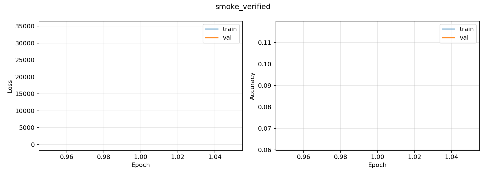
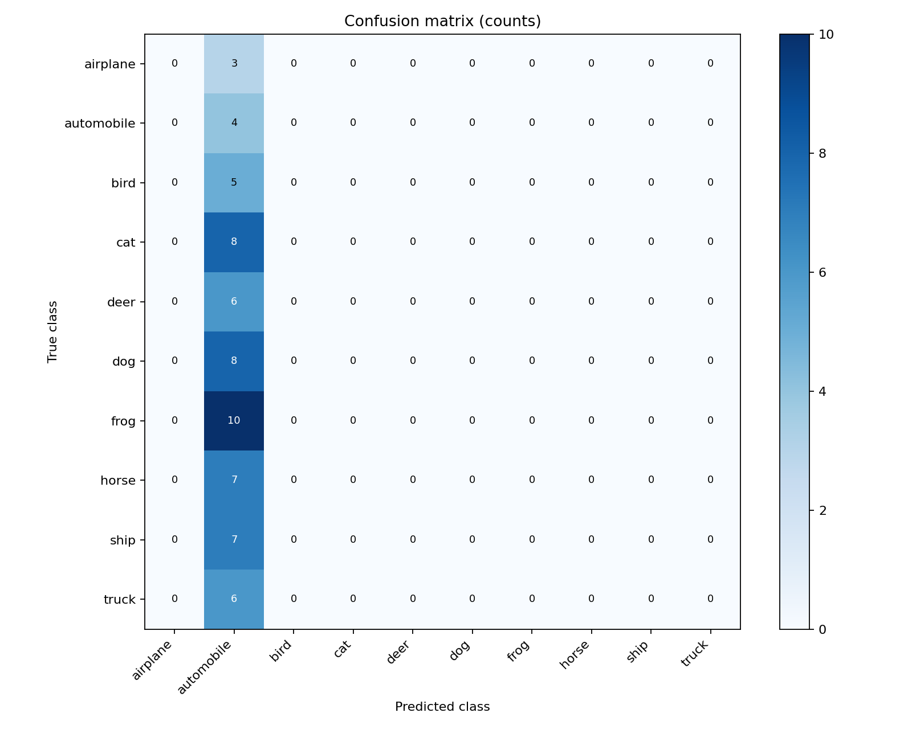

# smoke_verified

**SMOKE TEST ONLY: not a CIFAR-10 test-set result.**

- Model: CIFAR-adapted ResNet18, trained from scratch
- Split: validation_smoke (64 samples)
- Accuracy: 6.2500%
- Best validation epoch: 1
- Best validation accuracy: 6.2500%
- Training time: 6.0 seconds
- Device: cpu
- Seed: 42

